# Masar ERP — Database Architecture & ERD

## Overview
Masar ERP's relational database is built on **PostgreSQL 16** and managed through **Prisma ORM**. The schema is divided into 6 cohesive domains:
1. **Core / Auth & Multi-Tenancy Foundation**: Users, Roles, Permissions, RolePermissions, AuditLogs, CompanySettings, DocumentSequences.
2. **Inventory**: Categories (hierarchical), Units, Products, Warehouses, StockLevels, StockMovements.
3. **Sales**: Customers, SalesQuotations, SalesOrders, SalesInvoices, CustomerPayments, SalesReturns.
4. **Purchasing**: Suppliers, PurchaseOrders, GoodsReceipts, PurchaseInvoices, SupplierPayments.
5. **Accounting & General Ledger**: Chart of Accounts (hierarchical), JournalEntries, JournalLines, FiscalPeriods, Expenses.
6. **Human Resources (HR)**: Departments, Positions, Employees, Attendance, LeaveTypes, LeaveRequests, PayrollRuns, Payslips.

---

## Entity-Relationship Diagram (ERD)

```mermaid
erDiagram
    %% Core & Auth
    User ||--o{ AuditLog : "creates"
    Role ||--o{ User : "assigns"
    Role ||--o{ RolePermission : "has"
    Permission ||--o{ RolePermission : "granted"
    User |o--o| Employee : "linked to"

    %% Inventory
    Category ||--o{ Category : "parent of"
    Category ||--o{ Product : "categorizes"
    Unit ||--o{ Product : "measures"
    Product ||--o{ StockLevel : "tracked in"
    Warehouse ||--o{ StockLevel : "contains"
    Product ||--o{ StockMovement : "moved"
    Warehouse ||--o{ StockMovement : "stored"

    %% Sales
    Customer ||--o{ SalesQuotation : "requests"
    Customer ||--o{ SalesOrder : "places"
    Customer ||--o{ SalesInvoice : "billed"
    Customer ||--o{ CustomerPayment : "pays"
    Customer ||--o{ SalesReturn : "returns"

    SalesQuotation ||--o{ SalesQuotationItem : "contains"
    SalesQuotation ||--o{ SalesOrder : "converts to"
    SalesOrder ||--o{ SalesOrderItem : "contains"
    SalesOrder ||--o{ SalesInvoice : "fulfilled by"
    SalesInvoice ||--o{ SalesInvoiceItem : "contains"
    SalesInvoice ||--o{ CustomerPayment : "settled by"
    SalesInvoice ||--o{ SalesReturn : "credited by"
    SalesReturn ||--o{ SalesReturnItem : "contains"

    Product ||--o{ SalesQuotationItem : "quoted"
    Product ||--o{ SalesOrderItem : "ordered"
    Product ||--o{ SalesInvoiceItem : "invoiced"
    Product ||--o{ SalesReturnItem : "returned"

    %% Purchasing
    Supplier ||--o{ PurchaseOrder : "receives"
    Supplier ||--o{ GoodsReceipt : "ships"
    Supplier ||--o{ PurchaseInvoice : "bills"
    Supplier ||--o{ SupplierPayment : "paid by"

    PurchaseOrder ||--o{ PurchaseOrderItem : "contains"
    PurchaseOrder ||--o{ GoodsReceipt : "received via"
    PurchaseOrder ||--o{ PurchaseInvoice : "billed via"
    GoodsReceipt ||--o{ GoodsReceiptItem : "contains"
    Warehouse ||--o{ GoodsReceipt : "receives into"
    PurchaseInvoice ||--o{ PurchaseInvoiceItem : "contains"
    PurchaseInvoice ||--o{ SupplierPayment : "settled by"

    Product ||--o{ PurchaseOrderItem : "purchased"
    Product ||--o{ GoodsReceiptItem : "received"
    Product ||--o{ PurchaseInvoiceItem : "billed"

    %% Accounting
    Account ||--o{ Account : "parent of"
    Account ||--o{ JournalLine : "debited/credited"
    JournalEntry ||--o{ JournalLine : "composed of"
    Account ||--o{ Expense : "charged to"
    Account ||--o{ Expense : "paid from"

    %% HR
    Department ||--o{ Employee : "employs"
    Department ||--o{ Position : "defines"
    Position ||--o{ Employee : "assigned to"
    Employee ||--o{ Attendance : "logs"
    Employee ||--o{ LeaveRequest : "requests"
    LeaveType ||--o{ LeaveRequest : "categorizes"
    PayrollRun ||--o{ Payslip : "generates"
    Employee ||--o{ Payslip : "receives"
```

---

## Design Principles & Data Integrity

### 1. Primary Keys & Identifiers
- All tables use collision-resistant alphanumeric IDs (`cuid()`).
- Document numbers follow uniform, sequential year-prefixed formats (e.g. `INV-2026-00001`, `SO-2026-00001`) generated atomically via `lib/sequence.ts` and tracked in `DocumentSequence`.

### 2. Monetary Precision & Decimal Representation
- Currency values (`subtotal`, `tax`, `total`, `balance`, `costPrice`, `salePrice`, `debit`, `credit`, `salary`) use `@db.Decimal(15, 2)` to eliminate floating-point drift.
- Percentage and tax rates use `@db.Decimal(5, 2)` (e.g. `14.00` for 14% VAT).

### 3. Deletion Rules (`onDelete`)
- **Financial and Accounting Documents**: All relationships to `Customer`, `Supplier`, `Account`, `Product`, and `User` use `onDelete: Restrict`. This guarantees historical ledger entries and invoices can never be accidentally orphaned or purged.
- **Line Items**: Sub-items (`SalesInvoiceItem`, `JournalLine`, `PurchaseOrderItem`, etc.) use `onDelete: Cascade` with their parent document.
- **Audit & Metadata**: User references in `AuditLog` use `onDelete: SetNull`.

### 4. Soft Delete Pattern
- Business entities (`User`, `Product`, `Category`, `Warehouse`, `Customer`, `Supplier`, `Account`, `Expense`, `Department`, `Position`, `Employee`) include a nullable `deletedAt DateTime?` column. Queries filter active records with `where: { deletedAt: null }`.

### 5. Double-Entry Accounting Invariant
- Every journal transaction contains multiple `JournalLine` rows.
- Total Debits must strictly equal Total Credits before `JournalEntry` status transitions from `DRAFT` to `POSTED`.
